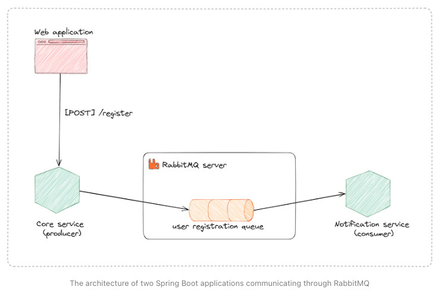
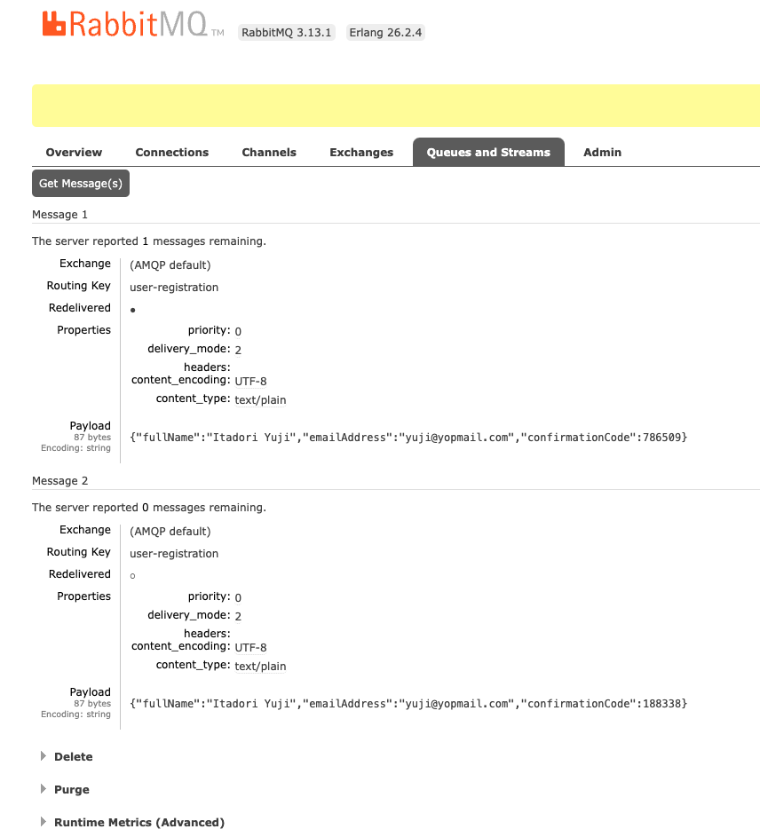

# spring-boot-rabbitmq-sample

[](https://github.com/hendisantika/spring-boot-rabbitmq-sample/actions/workflows/maven.yml)


[](.github/dependabot.yml)
[](LICENSE)

Spring Boot RabbitMQ Sample

Send and receive messages from a Spring boot applications using RabbitMQ.

AMQP is the protocol used to allow communication between many applications through a RabbitMQ server. To support most
programming languages, connectors will enable you to interact with the server by exchanging messages with others
applications using your favorite programming language.

We will use the Spring dependency for RabbitMQ to make two Spring Boot applications communicate together.

### The use case

RabbitMQ is great for event-driven applications, which will act as the bridge to exchange information between
applications.

Let's say we are building a website application where the core back-end communicates with a notification service
responsible for emailing users. When a user register, we must send a confirmation email with a confirmation code. The
email sending should not block the response to the client.

The picture below shows the system architecture.



### Tech stack

| Component         | Version / Detail                                               |
|-------------------|----------------------------------------------------------------|
| Java              | **JDK 25** (Temurin in CI)                                     |
| Spring Boot       | 4.1.x (`spring-boot-starter-amqp`, `spring-boot-starter-web`)  |
| JSON              | Jackson 3 (`tools.jackson.databind.json.JsonMapper`)           |
| Messaging         | RabbitMQ (AMQP 0-9-1)                                          |
| Build             | Maven (wrapper included in each module)                        |
| Boilerplate       | Lombok                                                         |

### Project structure

```text
spring-boot-rabbitmq-sample
├── producer   # REST API (port 8080) that publishes `UserRegisteredPayload` to the `user-registration` queue
├── consumer   # Listens to the `user-registration` queue and prints the received payload
├── img        # Screenshots used in this README
└── .github
    ├── workflows/maven.yml   # CI: builds & tests producer and consumer on JDK 25
    └── dependabot.yml        # Automated dependency updates
```

### Prerequisites

- JDK 25 (e.g. `sdk install java 25-tem`)
- A running RabbitMQ broker. To run one locally with Docker:

  ```shell
  docker run -d --name rabbitmq -p 5672:5672 -p 15672:15672 rabbitmq:management
  ```

  Then create the `user-registration` queue from the management UI at http://localhost:15672 (`guest` / `guest`).

### Things todo list

1. Clone this repository: `git clone https://github.com/hendisantika/spring-boot-rabbitmq-sample.git`
2. Navigate to directory: `cd spring-boot-rabbitmq-sample`
3. Navigate to producer service: `cd producer`
4. Open new terminal then navigate to consumer service: `cd consumer`
5. Run the application on each service: `./mvnw clean spring-boot:run`

The broker connection is configured in each module's `src/main/resources/application.properties`. You can override it
with environment variables, e.g. to use a local broker:

```shell
SPRING_RABBITMQ_HOST=localhost SPRING_RABBITMQ_USERNAME=guest SPRING_RABBITMQ_PASSWORD=guest ./mvnw spring-boot:run
```

### Build & test

```shell
cd producer && ./mvnw clean verify
cd consumer && ./mvnw clean verify
```

The tests start the Spring context with `spring.rabbitmq.listener.simple.auto-startup=false`, so they **do not need a
running RabbitMQ broker**.

### Continuous Integration

[GitHub Actions](.github/workflows/maven.yml) builds and tests both modules in parallel (matrix: `producer`,
`consumer`) on **JDK 25** for every push and pull request to `main`. On pushes to `main` it also submits the Maven
dependency graph to GitHub so Dependabot alerts are accurate.

### Dependabot

[Dependabot](.github/dependabot.yml) keeps dependencies up to date:

- **Maven** (`/producer` and `/consumer`) — checked daily at 05:00 (Asia/Jakarta). Updates are grouped into
  `spring-boot`, `spring`, `maven-plugins` and `minor-and-patch` to reduce PR noise.
- **GitHub Actions** — checked weekly (Monday 05:00 Asia/Jakarta), grouped into a single PR.
- PRs are labelled (`dependencies`, `java`, `producer`/`consumer`, `github_actions`), assigned to the maintainer and
  use conventional commit prefixes (`chore(deps)`, `ci(deps)`).

### Send Queue



```shell
POST http://localhost:8080/register
Content-Type: application/json

{
  "name": "Itadori Yuji",
  "email": "yuji@yopmail.com"
}
```

### Console log

#### Producer Log

```shell
  .   ____          _            __ _ _
 /\\ / ___'_ __ _ _(_)_ __  __ _ \ \ \ \
( ( )\___ | '_ | '_| | '_ \/ _` | \ \ \ \
 \\/  ___)| |_)| | | | | || (_| |  ) ) ) )
  '  |____| .__|_| |_|_| |_\__, | / / / /
 =========|_|==============|___/=/_/_/_/

 :: Spring Boot ::                (v3.3.0)

2024-06-10T07:03:09.821+07:00  INFO 16490 --- [producer] [           main] i.m.h.producer.ProducerApplication       : Starting ProducerApplication using Java 21 with PID 16490 (/Users/hendisantika/IdeaProjects/spring-boot-rabbitmq-sample/producer/target/classes started by hendisantika in /Users/hendisantika/IdeaProjects/spring-boot-rabbitmq-sample)
2024-06-10T07:03:09.823+07:00  INFO 16490 --- [producer] [           main] i.m.h.producer.ProducerApplication       : No active profile set, falling back to 1 default profile: "default"
2024-06-10T07:03:10.447+07:00  INFO 16490 --- [producer] [           main] o.s.b.w.embedded.tomcat.TomcatWebServer  : Tomcat initialized with port 8080 (http)
2024-06-10T07:03:10.454+07:00  INFO 16490 --- [producer] [           main] o.apache.catalina.core.StandardService   : Starting service [Tomcat]
2024-06-10T07:03:10.454+07:00  INFO 16490 --- [producer] [           main] o.apache.catalina.core.StandardEngine    : Starting Servlet engine: [Apache Tomcat/10.1.24]
2024-06-10T07:03:10.474+07:00  INFO 16490 --- [producer] [           main] o.a.c.c.C.[Tomcat].[localhost].[/]       : Initializing Spring embedded WebApplicationContext
2024-06-10T07:03:10.474+07:00  INFO 16490 --- [producer] [           main] w.s.c.ServletWebServerApplicationContext : Root WebApplicationContext: initialization completed in 598 ms
2024-06-10T07:03:10.868+07:00  INFO 16490 --- [producer] [           main] o.s.b.w.embedded.tomcat.TomcatWebServer  : Tomcat started on port 8080 (http) with context path '/'
2024-06-10T07:03:10.870+07:00  INFO 16490 --- [producer] [           main] o.s.a.r.c.CachingConnectionFactory       : Attempting to connect to: [rabbitmq.tericcabrel.com:5672]
2024-06-10T07:03:12.158+07:00  INFO 16490 --- [producer] [           main] o.s.a.r.c.CachingConnectionFactory       : Created new connection: rabbitConnectionFactory#29fa6b65:0/SimpleConnection@1e54a6b1 [delegate=amqp://admin@195.201.138.208:5672/, localPort=49969]
2024-06-10T07:03:12.178+07:00  INFO 16490 --- [producer] [           main] i.m.h.producer.ProducerApplication       : Started ProducerApplication in 2.8 seconds (process running for 3.383)
2024-06-10T07:03:19.559+07:00  INFO 16490 --- [producer] [nio-8080-exec-1] o.a.c.c.C.[Tomcat].[localhost].[/]       : Initializing Spring DispatcherServlet 'dispatcherServlet'
2024-06-10T07:03:19.559+07:00  INFO 16490 --- [producer] [nio-8080-exec-1] o.s.web.servlet.DispatcherServlet        : Initializing Servlet 'dispatcherServlet'
2024-06-10T07:03:19.560+07:00  INFO 16490 --- [producer] [nio-8080-exec-1] o.s.web.servlet.DispatcherServlet        : Completed initialization in 1 ms
2024-06-10T07:03:20.010+07:00  INFO 16490 --- [producer] [nio-8080-exec-1] i.m.h.p.controller.UserController        : User registered successfully!

```

#### Consumer Log

Consumer Log

```shell
  .   ____          _            __ _ _
 /\\ / ___'_ __ _ _(_)_ __  __ _ \ \ \ \
( ( )\___ | '_ | '_| | '_ \/ _` | \ \ \ \
 \\/  ___)| |_)| | | | | || (_| |  ) ) ) )
  '  |____| .__|_| |_|_| |_\__, | / / / /
 =========|_|==============|___/=/_/_/_/

 :: Spring Boot ::                (v3.3.0)

2024-06-10T07:04:48.839+07:00  INFO 16589 --- [consumer] [  restartedMain] i.m.h.consumer.ConsumerApplication       : Starting ConsumerApplication using Java 21 with PID 16589 (/Users/hendisantika/IdeaProjects/spring-boot-rabbitmq-sample/consumer/target/classes started by hendisantika in /Users/hendisantika/IdeaProjects/spring-boot-rabbitmq-sample)
2024-06-10T07:04:48.840+07:00  INFO 16589 --- [consumer] [  restartedMain] i.m.h.consumer.ConsumerApplication       : No active profile set, falling back to 1 default profile: "default"
2024-06-10T07:04:48.857+07:00  INFO 16589 --- [consumer] [  restartedMain] .e.DevToolsPropertyDefaultsPostProcessor : Devtools property defaults active! Set 'spring.devtools.add-properties' to 'false' to disable
2024-06-10T07:04:49.247+07:00  INFO 16589 --- [consumer] [  restartedMain] o.s.b.d.a.OptionalLiveReloadServer       : LiveReload server is running on port 35729
2024-06-10T07:04:49.276+07:00  INFO 16589 --- [consumer] [  restartedMain] o.s.a.r.c.CachingConnectionFactory       : Attempting to connect to: [rabbitmq.tericcabrel.com:5672]
2024-06-10T07:04:50.559+07:00  INFO 16589 --- [consumer] [  restartedMain] o.s.a.r.c.CachingConnectionFactory       : Created new connection: rabbitConnectionFactory#1bdf2afb:0/SimpleConnection@709c2e48 [delegate=amqp://admin@195.201.138.208:5672/, localPort=50560]
2024-06-10T07:04:51.784+07:00  INFO 16589 --- [consumer] [  restartedMain] i.m.h.consumer.ConsumerApplication       : Started ConsumerApplication in 3.297 seconds (process running for 3.809)
Message received
User full name:    Itadori Yuji
Email Address:     yuji@yopmail.com
Confirmation code: 786509
Message received
User full name:    Itadori Yuji
Email Address:     yuji@yopmail.com
Confirmation code: 188338

```
